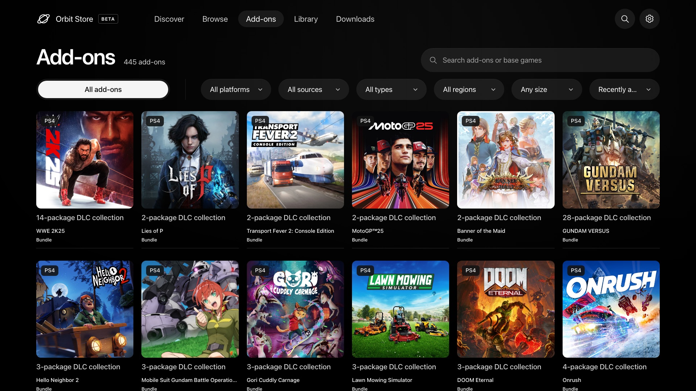

# Orbit Store 1.5.0 (Beta)

**A major update:** DLCs, game installation support and over 2,000 games now in Orbit.

- **Install without leaving Orbit.** After a PKG or FPKG downloads or transfers, choose **Install on PS5**. If a download has several packages, pick the ones you want. For exFAT, FFPFSC and extracted game folders, Orbit asks ShadowMount to scan for them, if a supported version is running.
- **445 add-ons for 78 games.** Browse and download expansions, content packs, activation packages and bundles on the new **Add-ons** page, or from a game’s details.
- **Over 2,000 games.** This update adds 195 games (188 PS4 and 7 PS5) and 71 more download choices for games already in Orbit. The catalogue now has 2,026 games.
- **Know what your firmware can run.** Download options show the firmware they need, when it’s known. Options that won’t run on your PS5 are listed last with a warning, and you can still download them.

## Orbit Store · Native PS5 app (FFPKG) and browser (ELF)

- **Update Orbit in one step.** **Update Orbit** updates the TV app and the download service together. If your ELF loader is running, Orbit restarts itself and picks up your downloads where they left off. You can also restart Orbit on its own from Updates.
- **Download notifications.** Your PS5 tells you when a download finishes or fails, in your console’s language. You can turn this off in settings.
- **Save a diagnostic report.** In the TV app, **More settings → Save diagnostic report** saves a report you can attach to a bug report, on a USB drive or the PS5’s own storage. It has no game titles, download links, passwords or tokens.
- **Better download retries.** Downloads resume from the progress saved on your drive, and Retry still works if the partial file was deleted or is empty.
- **Find the right add-on.** Search by add-on or game name, and filter by platform, type, source and region, in every interface. An add-on’s details show which game it needs, and any version it requires, before you download.

## Orbit Zero · Mac, Windows and Linux

- **Download DLC now, send it later.** Save add-ons to your computer without your PS5 connected, and send them when you’re ready.
- **Install from your computer.** After a package reaches your PS5, choose **Install on PS5** in Zero and watch its progress.
- **Pick up interrupted transfers after pairing again.** Zero checks the files already on your PS5 and carries on from where it stopped when they match. If it can’t, you can delete the partial copy and start over.
- **Steadier transfers to your PS5.** Zero now reads ahead and keeps data flowing while your PS5 writes to its drive.
- **Time remaining.** Downloads shows how long downloading and sending have left, including downloads your PS5 makes itself.
- **Firmware labels while your PS5 is off.** Zero remembers the firmware of the last PS5 you paired, and forgets it when you unpair.
- **Export a log for bug reports.** **Download settings → Export log** saves Zero’s recent activity and, while connected, your PS5’s diagnostic report. It has no game titles, file names, folders, links, passwords or tokens.
- **More reliable artwork.** Game and add-on covers load more reliably.

 

 

 

[Install Orbit Zero on Mac, Windows or Linux](https://github.com/saawant12/orbit-store-ps5/blob/main/guides/orbit-zero-installation.md) · [Update Orbit Store on PS5](https://github.com/saawant12/orbit-store-ps5/blob/main/guides/getting-started.md#update-the-tv-app)

 

## Install Orbit Zero on your computer

Choose the package matching your computer from **Assets**: macOS DMG, Windows installer or ZIP, or Ubuntu/Debian DEB. Linux TAR.GZ packages are also available. Both ARM64 and x64 builds are included; Linux DEB names use **amd64** for Intel/AMD computers. Quit the older app before installing the new version. See the [installation guide](https://github.com/saawant12/orbit-store-ps5/blob/main/guides/orbit-zero-installation.md) for setup and operating-system permissions.

## Install the native TV app (FFPKG)

Download `PPSA99177.ffpkg` from **Assets**, verify its `.sha256`, and copy it to `/data/homebrew/` on your PS5. Let ShadowMountPlus register it, then open **Orbit Store** from the Games row. The native app is **1.9.1**, bundled with Orbit Store **1.5.0**.

If an older Orbit service is running, select **App settings → Update / reinstall → Stop Orbit to restart** in its browser interface before opening the updated app so the new service can start. Pairing, settings and your queue remain saved. [Native installation and update guide](https://github.com/saawant12/orbit-store-ps5/blob/main/guides/getting-started.md#update-the-tv-app).

## Use or update the browser version (ELF)

Download `orbit_store.elf` and its `.sha256` from **Assets**, verify the checksum, then run the ELF through Payload Manager or your ELF loader. Open the Orbit shortcut in the Media tab, or `http://<ps5-ip>:34177/` on another device on the same local network.

To replace a running older version, select **App settings → Update / reinstall → Stop Orbit to restart**, then launch the new ELF. Orbit Zero also includes the matching ELF under **Console → Start Orbit on PS5**, so you can upload it from your computer without downloading the ELF separately.

Once running 1.5.0, **Update Orbit** in Updates handles the TV app and service together. Keep your local ELF loader running on port 9021 for automatic service restart; follow Orbit’s manual instructions if it is unavailable. Reopen the TV app after updating it.

## Downloads and source

- `orbit_store.elf` is the PS5 service and browser interface; `PPSA99177.ffpkg` is the native TV app with the same service included.
- `Orbit-Zero-1.5.0-*` files are the desktop packages. Choose the operating system and architecture matching your computer.
- `orbit-store-1.5.0-source-bundle.zip` contains the corresponding Store application and dependency sources, licence notices and rebuild instructions.
- `SHA256SUMS` covers the release assets. Verify a binary with `shasum -a 256 -c <filename>.sha256`, or use `SHA256SUMS` for the desktop packages.

 

**Edit · Native app 1.9.1:** Fixed an issue where pressing X on an add-on in the default Store layout could open an unrelated game. Update `PPSA99177.ffpkg` to get the fix.
